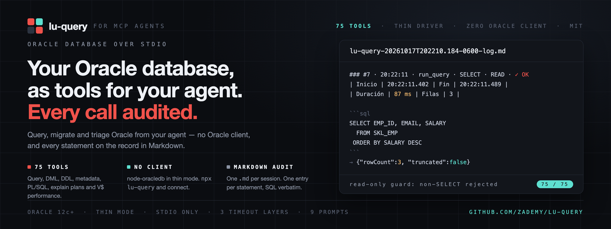

[](https://www.npmjs.com/package/lu-query)
[](https://github.com/zademy/lu-query/blob/master/LICENSE)
[](https://nodejs.org)

## Watch the promo

[](https://github.com/zademy/lu-query/raw/master/docs/lu-query-promo.mp4)

**[▶ Watch the 33-second promo (MP4, 1080p30)](https://github.com/zademy/lu-query/raw/master/docs/lu-query-promo.mp4)** - 75 tools, zero-install thin mode and a Markdown audit, in 33 seconds.
[Download the file](https://github.com/zademy/lu-query/blob/master/docs/lu-query-promo.mp4) | [Remotion source](https://github.com/zademy/lu-query/tree/develop/video)

MCP server that exposes an Oracle database to MCP clients over **stdio** - 75 tools for querying, changing, inspecting and triaging it, with zero-install thin mode and a Markdown audit of every statement.

## Requirements

- Node.js >= 22
- Oracle Database 12c+ (developed and tested against Oracle Database 26ai Free)
- No Oracle Client installation: node-oracledb runs in thin mode

## Quick start

```bash
npx lu-query
```

Client configuration (Claude Desktop example; any MCP client works):

```json
{
  "mcpServers": {
    "lu-query": {
      "command": "npx",
      "args": ["lu-query"],
      "env": {
        "ORACLE_DB_URL": "jdbc:oracle:thin:@//db.host:1521/FREEPDB1",
        "ORACLE_DB_USERNAME": "app_user",
        "ORACLE_DB_PASSWORD": "secret"
      }
    }
  }
}
```

The pool is lazy: the server starts and answers `initialize` without a database; the first tool call opens the connection.

## Configuration

| Variable                      | Required  | Default              | Purpose                                                                                                |
| ----------------------------- | --------- | -------------------- | ------------------------------------------------------------------------------------------------------ |
| `ORACLE_DB_URL`               | yes       | —                    | Connect string: JDBC (`jdbc:oracle:thin:@//host:1521/service`) or easy-connect (`host:1521/service`)   |
| `ORACLE_DB_USERNAME`          | yes       | —                    | Database user                                                                                          |
| `ORACLE_DB_PASSWORD`          | yes       | —                    | Database password                                                                                      |
| `ORACLE_DB_SCHEMA`            | no        | session default      | Schema set via `ALTER SESSION SET CURRENT_SCHEMA` on each pooled session                               |
| `ORACLE_POOL_SIZE`            | no        | `4`                  | Connection pool size                                                                                   |
| `MCP_SERVER_VERSION`          | no        | `2.13.0`             | Version reported by the server                                                                         |
| `MCP_AUDIT_ENABLED`           | no        | `true`               | Session audit on by default — the only contract change vs the Java server (which defaulted to `false`) |
| `MCP_AUDIT_DIR`               | no        | `./mcp-audit-logs`   | Directory for audit Markdown files                                                                     |
| `SENTRY_ENABLED`              | no        | `false`              | Error reporting to Sentry                                                                              |
| `SENTRY_DSN`                  | if Sentry | —                    | Sentry DSN                                                                                             |
| `SENTRY_ENV`                  | no        | —                    | Sentry environment                                                                                     |
| `SENTRY_RELEASE`              | no        | `MCP_SERVER_VERSION` | Sentry release                                                                                         |
| `SENTRY_SEND_DEFAULT_PII`     | no        | `false`              | PII in Sentry events                                                                                   |
| `SENTRY_AUTH_TOKEN`           | no        | —                    | Accepted for config parity; unused at runtime (`@sentry/node` has no such setting)                     |
| `LOG_LEVEL` / `APP_LOG_LEVEL` | no        | `INFO`               | Server log level                                                                                       |

**Limits.** Result sets are capped at 1000 rows. Three timeout layers: statement 120 s, socket 30 s, MCP request watchdog 150 s. Identifiers are validated against `^[A-Za-z][A-Za-z0-9_$#]{0,127}$`; literals are escaped (`'` -> `''`).

## Session audit

Every session writes one Markdown file `lu-query-<timestamp>-log.md` in `MCP_AUDIT_DIR`, with one entry per tool execution: tool name, statement kind (SELECT, INSERT, ...) and type (READ/WRITE/OTHER), duration, rows, parameters and the SQL verbatim.

````markdown
### #1 · 11:33:52 · test_connection · SELECT · READ · ✅ OK

| Inicio | 11:33:52.410 | Fin | 11:33:52.492 | Duración | 82 ms | Filas | 1 | Parámetros | |

```sql
SELECT * FROM V$VERSION
```
````

Read a session back with the resource `oracle://audit/session/{id}` (autocomplete offers `current` and recent ids). Audit disables itself on I/O errors and says so on stderr. Set `MCP_AUDIT_ENABLED=false` to turn it off. Audit files contain every statement executed — protect the directory (see [SECURITY.md](https://github.com/zademy/lu-query/blob/master/SECURITY.md)).

## Tools (75)

### System (1)

| Tool              | Purpose                                                                   |
| ----------------- | ------------------------------------------------------------------------- |
| `test_connection` | Connectivity check: database version, name, current user/schema, instance |

### Query (2)

| Tool              | Purpose                                                                                |
| ----------------- | -------------------------------------------------------------------------------------- |
| `run_query`       | Run a single SELECT (verbatim, CTEs allowed) with optional `offset`/`limit` pagination |
| `get_sample_data` | First N rows of a table (default 10, max 1000) with progress notifications             |

### DML (3)

| Tool                         | Purpose                                                                                      |
| ---------------------------- | -------------------------------------------------------------------------------------------- |
| `execute_dml`                | Execute one INSERT/UPDATE/DELETE/MERGE and commit                                            |
| `execute_dml_preview`        | Dry-run an UPDATE/DELETE: rows that would be affected plus the WHERE breakdown, no execution |
| `execute_dml_rollback_first` | Execute DML inside a transaction that is immediately rolled back — nothing persists          |

### DDL (7)

| Tool                     | Purpose                                                                         |
| ------------------------ | ------------------------------------------------------------------------------- |
| `comment_on_table`       | Add or replace a table comment (own tables only)                                |
| `comment_on_column`      | Add or replace a column comment (own tables only)                               |
| `create_or_replace_view` | Create or replace a view in the user's own schema                               |
| `create_synonym`         | Create a private or public synonym for another schema's object                  |
| `create_sequence`        | Create a sequence in the user's own schema                                      |
| `create_index`           | Create an index on a table (columns array; table ownership or CREATE ANY INDEX) |
| `create_mview_log`       | Create a materialized-view log for fast refresh                                 |

### Metadata — core (8)

| Tool             | Purpose                                                               |
| ---------------- | --------------------------------------------------------------------- |
| `list_schemas`   | List schemas (users) visible to the connection                        |
| `list_tables`    | List tables with optional schema and LIKE pattern                     |
| `list_views`     | List views with optional schema and LIKE pattern                      |
| `describe_table` | Columns of a table: type, nullability, default, comment               |
| `table_exists`   | true/false via ALL_TABLES (views not considered)                      |
| `search_objects` | Search objects by case-insensitive LIKE pattern, optional type filter |
| `list_objects`   | List objects by schema and type (tables, views, packages, ...)        |
| `get_ddl`        | DDL of an object via DBMS_METADATA.GET_DDL (as CLOB string)           |

### Metadata — catalog (21)

| Tool                      | Purpose                                                         |
| ------------------------- | --------------------------------------------------------------- |
| `list_indexes`            | Indexes of a table with columns, uniqueness, status             |
| `list_constraints`        | PK/FK/unique/check constraints with columns and references      |
| `list_sequences`          | Sequences with range, increment, last number, cycle, cache      |
| `get_sequence_info`       | Metadata of a single sequence                                   |
| `list_triggers`           | Triggers with type, event, table, status                        |
| `list_procedures`         | Procedures, functions, packages, types                          |
| `list_synonyms`           | Private/public synonyms with resolved target and DB link        |
| `list_db_links`           | Database links visible to the user                              |
| `list_directories`        | Directory objects and filesystem paths                          |
| `list_external_tables`    | External tables: driver, directory, reject limit, access params |
| `list_materialized_views` | MViews with refresh mode/method, last refresh, staleness        |
| `list_mview_logs`         | Materialized-view logs on tables                                |
| `list_partitions`         | Table partitions: high value, rows, compression, last analyzed  |
| `list_ind_partitions`     | Index partitions: status, leaf blocks, distinct keys            |
| `list_subpartitions`      | Subpartitions of a composite-partitioned table                  |
| `list_lob_columns`        | LOB columns: segment, index, caching, SECUREFILE, retention     |
| `list_types`              | User-defined types: typecode, attributes, methods, supertype    |
| `list_invalid_objects`    | Objects with status INVALID (broken code)                       |
| `list_dependencies`       | Objects a given object depends on (impact analysis)             |
| `list_scheduler_jobs`     | Scheduler jobs: state, run/failure counts, next run             |
| `list_scheduler_job_runs` | Recent job run details: duration, error code, output            |

### Optimizer statistics & health (7)

| Tool                       | Purpose                                                                                                    |
| -------------------------- | ---------------------------------------------------------------------------------------------------------- |
| `get_table_stats`          | Table optimizer stats: rows, blocks, avg row length, last analyzed                                         |
| `get_column_stats`         | Column stats: NDV, density, nulls, buckets                                                                 |
| `get_histogram`            | Histogram endpoints of a column                                                                            |
| `get_session_privs`        | Granted and effective system privileges                                                                    |
| `get_session_roles`        | Enabled roles with admin/default flags                                                                     |
| `get_plsql_errors`         | Compilation errors of PL/SQL units                                                                         |
| `oracle_mcp_health_report` | One-shot readiness check: connectivity, version, catalog role, invalid objects, server config, audit state |

### PL/SQL (2)

| Tool             | Purpose                                                                                       |
| ---------------- | --------------------------------------------------------------------------------------------- |
| `describe_plsql` | Arguments and full source of a PL/SQL object                                                  |
| `call_procedure` | Execute a procedure/function/package subprogram with IN/OUT/INOUT args and REF CURSOR returns |

### Explain & tuning (4)

| Tool                     | Purpose                                                                            |
| ------------------------ | ---------------------------------------------------------------------------------- |
| `explain_plan`           | Execution plan via EXPLAIN PLAN + DBMS_XPLAN without executing the statement       |
| `suggest_index`          | Analyse a statement's plan; propose CREATE INDEX when a table is read by full scan |
| `list_unused_indexes`    | Indexes with columns and best-effort usage info                                    |
| `run_sql_tuning_advisor` | DBMS_SQLTUNE report with recommendations                                           |

### Graphs & helpers (7)

| Tool                      | Purpose                                                                          |
| ------------------------- | -------------------------------------------------------------------------------- |
| `get_next_sequence_value` | NEXTVAL of a sequence — side-effecting read: it advances the counter             |
| `validate_fk_integrity`   | Orphan rows per FK of a table (empty list = integrity intact)                    |
| `find_free_id`            | Lowest free id in 1..maxRange (default 1000, cap 10000) not present in the table |
| `find_duplicates`         | Duplicate value groups in one or more columns (NULLs excluded)                   |
| `count_rows`              | Exact row count of a table without running SQL                                   |
| `get_dependency_graph`    | Object-dependency graph of a schema (Mermaid)                                    |
| `get_fk_graph`            | Foreign-key graph of a schema or table (Mermaid)                                 |

### Performance — V$ views (13)

Requires `SELECT ANY DICTIONARY` (or equivalent) on the database user; tools return a grant hint on ORA-00942/01031.

| Tool                    | Purpose                                                                            |
| ----------------------- | ---------------------------------------------------------------------------------- |
| `list_active_sessions`  | ACTIVE sessions: user, machine, program, last call elapsed                         |
| `list_blocked_sessions` | Blocked sessions with blocker sid/user and wait event                              |
| `list_locks`            | DML/transaction/user locks held and requested, object and decoded mode             |
| `get_session_sql_text`  | Full SQL text currently executed by a session (sid + serial#)                      |
| `list_top_sql`          | Top-N SQL by buffer_gets (default), disk_reads, elapsed_time, executions, cpu_time |
| `get_wait_events`       | Current waits from V$SESSION_WAIT, optional sid/class filter                       |
| `get_session_longops`   | Long-running operations with progress from V$SESSION_LONGOPS                       |
| `get_instance_info`     | Instance name, host, version, startup time, status, archiver                       |
| `get_database_info`     | Database name, creation, log mode, open mode, role                                 |
| `get_system_stats`      | Cumulative V$SYSSTAT stats: parses, DB time, physical IO                           |
| `get_db_time_model`     | V$SYS_TIME_MODEL: DB CPU, DB time, parse times                                     |
| `get_parameter`         | Initialization parameters from V$PARAMETER                                         |
| `list_datafile_io`      | Datafiles with size, reads/writes and average IO time                              |

## Resources (4)

| URI template                                   | Purpose                                                              |
| ---------------------------------------------- | -------------------------------------------------------------------- |
| `oracle://audit/session/{id}`                  | Markdown audit log of a session (`current` resolves to the live one) |
| `oracle://schema/{schema}/table/{table}`       | Column-level description of a table or view                          |
| `oracle://schema/{schema}/object/{object}/ddl` | DDL source of any object (type auto-detected)                        |
| `oracle://schema/{schema}/plsql/{object}`      | PL/SQL source (procedure, function, package, type body)              |

## Prompts (9)

`review-sql-performance`, `explain-schema`, `debug-invalid-plsql`, `safe-dml-plan`, `data-quality-audit`, `triage-database-incident`, `prepare-plsql-call`, `operating-rules`, `oracle-sql-style` — read-only working guides for common Oracle tasks through these tools.

## Agent skills (optional)

Eight task-based skills that teach an agent how to use these 75 tools well - which tool for which job, in what order, what mutates, how failures look, how to read results. Install them with the [`skills`](https://www.npmjs.com/package/skills) CLI, which puts each skill where your agent looks for them:

```bash
npx skills@latest add zademy/lu-query           # install the eight skills
npx skills@latest add zademy/lu-query --list    # just show them
```

Useful flags: `-g` install globally instead of per project, `-a <agent>` pick the target (`claude-code`, `opencode`, `cursor`, `codex`, `gemini-cli`, …), `-s <skill>` install one skill (or `'*'` for all), `--copy` copy instead of symlink.

No CLI? Copy them by hand - each folder is self-contained (`SKILL.md` + `references/`):

```bash
cp -r node_modules/lu-query/skills/lu-query-* ~/.claude/skills/   # Claude Code and OpenCode
```

Skills: `lu-query-explore-schema`, `lu-query-query-data`, `lu-query-audit-data-quality`, `lu-query-plan-data-changes`, `lu-query-manage-schema`, `lu-query-use-plsql`, `lu-query-tune-sql`, `lu-query-triage-incident`. Catalog and examples provenance: [`skills/README.md`](https://github.com/zademy/lu-query/blob/master/skills/README.md). Installing the server never installs skills on its own.

## Security

See [SECURITY.md](https://github.com/zademy/lu-query/blob/master/SECURITY.md). Highlights: stdio only (no ports), identifier allow-list, escaped literals, audit directory must be protected. The database user should be least-privilege: the server relies on Oracle grants, not on its own checks, for anything the tools do not validate.

## Contributing

See [CONTRIBUTING.md](https://github.com/zademy/lu-query/blob/master/CONTRIBUTING.md). Releasing to npm is manual and done by the maintainer. Vocabulary in [GLOSSARY.md](https://github.com/zademy/lu-query/blob/master/GLOSSARY.md); decisions in [docs/adr/](https://github.com/zademy/lu-query/blob/master/docs/adr/).

## License

MIT (c) 2026 Sadot Hernández Moreno
